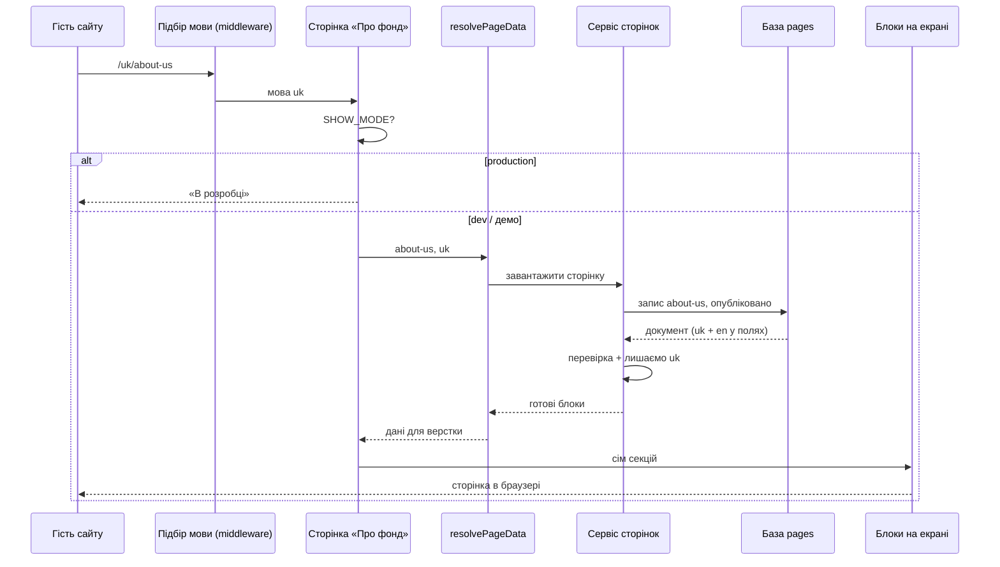

# Сторінка «Про фонд»

## Короткий опис фічі

«Про фонд» — це статична сторінка сайту за адресами `/uk/about-us` і `/en/about-us`. Відвідувач читає про фундацію: місію, цілі, напрями роботи, коротко про команду. Усю цю верстку наповнюють тексти, зображення й цитати з MongoDB (база даних).

У навчальному шаблоні база тримається в пам’яті й щоразу при `npm run dev` знову наповнюється демо-набором. Перезапустили сервер — контент «скинувся» до демо.

Через сам сайт ніхто сторінку не редагує, лише дивиться. Назву й короткий опис для Google беруть з файлів перекладів, не з бази.

Якщо в `.env` стоїть `SHOW_MODE=production`, замість сторінки показують заглушку «В розробці».

## User stories

### US-1 Мова з адреси

Як відвідувач, я хочу відкрити «Про фонд» українською або англійською, щоб читати однією мовою, без змішування текстів.

**Acceptance Criteria**

1. Сторінка відкривається за `/uk/about-us` і `/en/about-us`.
2. Блоки на сторінці показують текст мовою з URL (`uk` або `en`).
3. Якщо перекладу для цієї мови немає, користувач бачить зрозумілу сторінку помилки, а не порожній екран.

### US-2 Зміст на одному екрані

Як відвідувач, я хочу за один захід побачити вступ, місію, цілі, засновників і напрями роботи, щоб швидко зрозуміти, хто ми і навіщо.

**Acceptance Criteria**

1. Сторінка завжди показує сім блоків у тому ж порядку: вступ, про організацію, місія, цілі, цитата про кабінет Лятошинського, «Що ми робимо», засновники.
2. У меню сайту є пункт із посиланням `/about-us`.
3. У демо середовищі тексти збігаються з тим, що закладено в стартовий набір даних (seed).

### US-3 Коли контенту немає

Як відвідувач, я хочу отримати зрозумілу відповідь, якщо сторінки в базі немає, щоб не здавалося, що сайт зламався.

**Acceptance Criteria**

1. Немає запису з кодом сторінки `about-us` — показується «Не знайдено».
2. Дані в базі пошкоджені або неповні — сервер відловлює помилку на своїй стороні (перевірка схемою Zod), а не ламає сторінку без пояснення.

## Діаграма потоку даних

У режимі чорнетки (Next.js draft mode) підтягують не опубліковану версію, а чернетку з іншої колекції. У навчальному шаблоні чернетку для «Про фонд» зазвичай не заповнюють — попередній перегляд може бути порожнім.

## Таблиця ключових файлів

| Шлях у репозиторії | Призначення (простими словами) |
| --- | --- |
| `app/[lang]/about-us/page.tsx` | Збирає сторінку з блоків після завантаження даних |
| `app/services/pages-data/resolvePageData.ts` | Вирішує: опублікована версія чи чернетка |
| `app/services/pages-data/pagesDataService.ts` | Дістає сторінку з бази, перевіряє й підставляє одну мову |
| `app/infrastructure/repositories/pages-data/pagesData.repository.ts` | Читає запис у MongoDB за кодом сторінки |
| `app/validators/pagesSchemas/pages/about-us.schema.ts` | Описує, які поля має мати сторінка «Про фонд» |
| `scripts/seed-memory-mongo.js` | Кладе демо-тексти в базу при старті |
| `i18n/messages/uk.json`, `en.json` | Заголовок і опис для пошуку (meta) |

## Відкриті питання

1. У `SHOW_MODE=production` заглушка — це лише для демо, чи в продакшені теж так лишається?
2. Чи з’явиться адмінка для правки блоків, чи контентом керують повністю поза цим репозиторієм?
3. Чи треба в курсі окремо наповнювати чернетки (`draftpages`), щоб draft mode показував «Про фонд»?
