# Application architecture

This map shows how a page reaches data. Use it to see whether a change goes through an API route or straight to a service.

The site has five layers. `app/[lang]/` renders pages. `app/api/` answers browser requests. `app/services/` holds the business operations. `app/di/container.ts` wires a service to its repository. `app/infrastructure/` stores repositories, Mongoose models, and `db/connect.ts`.

## Browser requests

These pages call `app/api/` from the browser. The route resolves a service through `app/di/container.ts`.

```mermaid
flowchart TD
  subgraph pages["app/[lang]"]
    archivePage["archive/page.tsx"]
    artistryPage["artistry/page.tsx"]
    researchPage["research/page.tsx"]
    contactsPage["contacts/ContactsInfo/ContactsInfo.tsx"]
    cooperationPage["cooperation/page.tsx"]
    layout["layout.tsx"]
  end

  subgraph api["app/api"]
    fundsRoute["funds/route.ts"]
    compFilters["compositions/filters/route.ts"]
    compData["compositions/data/route.ts"]
    compTitles["compositions/titles/route.ts"]
    sciFilters["scientific-works/filters/route.ts"]
    sciData["scientific-works/data/route.ts"]
    sciTitles["scientific-works/titles/route.ts"]
    collabRoute["collaboration/route.ts"]
    blobRoute["blob-url/route.ts"]
  end

  subgraph services["app/services"]
    fundsService["funds/fundsService.ts"]
    artistryService["artistry/artistryService.ts"]
    sciService["scientific-works/scientificWorks.ts"]
  end

  subgraph infra["app/infrastructure"]
    fundsRepo["repositories/funds/funds.repository.ts"]
    fundModel["models/archive/Fund.ts"]
    caseModel["models/archive/Case.ts"]
    docModel["models/archive/Document.ts"]
    compRepo["repositories/artistry/compositions.repository.ts"]
    genreModel["models/artistry/artistryGenreData.ts"]
    categoryModel["models/artistry/artistryCategoriesData.ts"]
    opusModel["models/artistry/artistryOpusData.ts"]
    compositionsModel["models/artistry/artistryTableData.ts"]
    sciRepo["repositories/scientific-works/scientificWorks.repository.ts"]
    authorModel["models/scientific-works/scientificWorksAuthor.ts"]
    worksModel["models/scientific-works/scientificWorksTableData.ts"]
  end

  archivePage --> fundsRoute
  artistryPage --> compFilters
  artistryPage --> compData
  artistryPage --> compTitles
  artistryPage --> blobRoute
  researchPage --> sciFilters
  researchPage --> sciData
  researchPage --> sciTitles
  contactsPage --> collabRoute
  cooperationPage --> collabRoute
  layout --> blobRoute

  fundsRoute --> fundsService
  compFilters --> artistryService
  compData --> artistryService
  compTitles --> artistryService
  sciFilters --> sciService
  sciData --> sciService
  sciTitles --> sciService

  fundsService --> fundsRepo
  artistryService --> compRepo
  sciService --> sciRepo

  fundsRepo --> fundModel
  fundsRepo --> caseModel
  fundsRepo --> docModel
  compRepo --> genreModel
  compRepo --> categoryModel
  compRepo --> opusModel
  compRepo --> compositionsModel
  sciRepo --> authorModel
  sciRepo --> worksModel
```

`collaboration/route.ts` only checks the form fields. `blob-url/route.ts` reads a file from `public/` and does not use a service.

## Server requests

These pages resolve a service in `app/di/container.ts` and skip `app/api/`.

```mermaid
flowchart TD
  subgraph pages["app/[lang]"]
    home["page.tsx"]
    about["about-us/page.tsx"]
    biography["biography/page.tsx"]
    privacy["privacy-policy/page.tsx"]
    research["research/page.tsx"]
    cooperation["cooperation/page.tsx"]
    news["news/page.tsx"]
    contacts["contacts/page.tsx"]
    support["support-us/page.tsx"]
    casePage["archive/[fund]/[case]/page.tsx"]
    layout["layout.tsx"]
  end

  subgraph services["app/services"]
    resolve["pages-data/resolvePageData.ts"]
    pagesSvc["pages-data/pagesDataService.ts"]
    newsSvc["news/newsService.ts"]
    mediaSvc["media-mentions/mediaMentionService.ts"]
    footerSvc["footer/footerService.ts"]
    headerSvc["header/headerService.ts"]
    fundsSvc["funds/fundsService.ts"]
  end

  subgraph infra["app/infrastructure"]
    pagesRepo["repositories/pages-data/pagesData.repository.ts"]
    pagesModel["models/pages/pages.ts"]
    draftModel["models/pages/draftPages.model.ts"]
    newsRepo["repositories/news/news.repository.ts"]
    newsModel["models/news/news.model.ts"]
    mediaRepo["repositories/media-mentions/mediaMention.repository.ts"]
    mediaModel["models/media-mentions/mediaMention.model.ts"]
    navRepo["repositories/navigation/navigation.repository.ts"]
    navModel["models/navigation/navigation.ts"]
    infoRepo["repositories/foundation-info/foundationInfo.repository.ts"]
    branding["models/foundation-info/foundationInfoBranding.ts"]
    contactInfo["models/foundation-info/foundationInfoContact.ts"]
    publicInfo["models/foundation-info/foundationInfoPublic.ts"]
  end

  home --> resolve
  about --> resolve
  biography --> resolve
  privacy --> resolve
  research --> resolve
  cooperation --> pagesSvc
  resolve --> pagesSvc
  pagesSvc --> pagesRepo
  pagesRepo --> pagesModel
  pagesRepo --> draftModel

  news --> newsSvc
  news --> mediaSvc
  home --> newsSvc
  newsSvc --> newsRepo
  newsRepo --> newsModel
  mediaSvc --> mediaRepo
  mediaRepo --> mediaModel

  contacts --> footerSvc
  support --> footerSvc
  layout --> headerSvc
  layout --> footerSvc
  headerSvc --> navRepo
  headerSvc --> infoRepo
  footerSvc --> navRepo
  footerSvc --> infoRepo
  navRepo --> navModel
  infoRepo --> branding
  infoRepo --> contactInfo
  infoRepo --> publicInfo

  casePage --> fundsSvc
```

`resolvePageData.ts` uses `pagesDataService` for a published page. In draft mode it uses `draftPagesDataService` from the same file, which reads `draftPages.model.ts`. The home page also loads news through `app/shared/components/blocks/news-section/NewsSection.tsx`. `research/page.tsx` and `cooperation/page.tsx` load their blocks on the server and still call the browser routes shown above. The archive case page uses the same `fundsService.ts` and `funds.repository.ts` as `funds/route.ts`. Layout reaches the header and footer through `app/shared/components/Header/Header.server.tsx`.

## API routes no page calls

| Route | What it uses |
| --- | --- |
| `page/route.ts` | `pagesDataService.ts` |
| `header/route.ts` | `headerService.ts` |
| `contact/route.ts` | field checks only |
| `create-invoice/route.ts` | returns an error; donations are disabled in this demo |
| `preview/route.ts` | auth check and draft mode |
| `health/route.ts` | `db/connect.ts` |
| `docs/route.ts`, `verify/route.ts`, `config/route.ts` | no service from `app/di/` |

`app/services/client/headerService.ts` would call `header/route.ts`, but no page imports it. The header on the site uses `headerService.ts` on the server.

## Services with no caller

`app/di/modules/composedServices.module.ts` also registers `services/upload/upload.ts` and the email helper `services/email/emailService.ts`. `blob-url/route.ts` does not use the upload service. The contact and collaboration forms do not send mail.

`terms/page.tsx`, `war-in-ukraine/page.tsx`, and `archive/[fund]/page.tsx` do not use these services. The fund page renders the mock in `app/shared/components/tables/DocumentsTable/documents.mock`.
